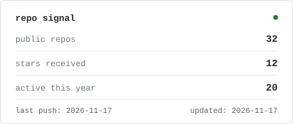
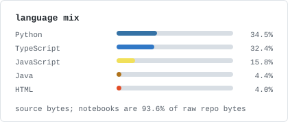

I’m exploring Linux and want to learn C. I’m also studying data on DataCamp and learning Chinese.

<!-- recent-work:start -->

## Recent work

- PR · [Fix tiny percentage and battery icon on Omarchy 4.5](<https://github.com/Paul-Bob/omarchy-super-battery/pull/4>) · `Paul-Bob/omarchy-super-battery`
- Issue · [&#91;Plugin&#93;: Gentle Night Light](<https://github.com/omacom/omarchy-plugin-marketplace/issues/15604>) · `omacom/omarchy-plugin-marketplace`
- Commit · [Release Gentle Night Light 0.2.1](<https://github.com/Kinosaur/omarchy-gentle-nightlight/commit/c1806b26f6f4e6633b263e2dad6b7623bca26de2>) · `Kinosaur/omarchy-gentle-nightlight`

<!-- recent-work:end -->

## GitHub activity

  <picture>
    <source media="(max-width: 600px) and (prefers-color-scheme: dark)" srcset="./assets/stats/dark/github-stats.svg" width="420" height="178" />
    <source media="(max-width: 600px)" srcset="./assets/stats/light/github-stats.svg" width="420" height="178" />
    <source media="(prefers-color-scheme: dark)" srcset="./assets/stats/dark/github-stats.svg" />
    <source media="(prefers-color-scheme: light)" srcset="./assets/stats/light/github-stats.svg" />
    
  </picture>
  <picture>
    <source media="(max-width: 600px) and (prefers-color-scheme: dark)" srcset="./assets/stats/dark/top-languages.svg" width="420" height="178" />
    <source media="(max-width: 600px)" srcset="./assets/stats/light/top-languages.svg" width="420" height="178" />
    <source media="(prefers-color-scheme: dark)" srcset="./assets/stats/dark/top-languages.svg" />
    <source media="(prefers-color-scheme: light)" srcset="./assets/stats/light/top-languages.svg" />
    
  </picture>

<picture>
  <source media="(prefers-color-scheme: dark)" srcset="https://raw.githubusercontent.com/Kinosaur/Kinosaur/output/github-snake-dark.svg" />
  <source media="(prefers-color-scheme: light)" srcset="https://raw.githubusercontent.com/Kinosaur/Kinosaur/output/github-snake.svg" />
  
</picture>
